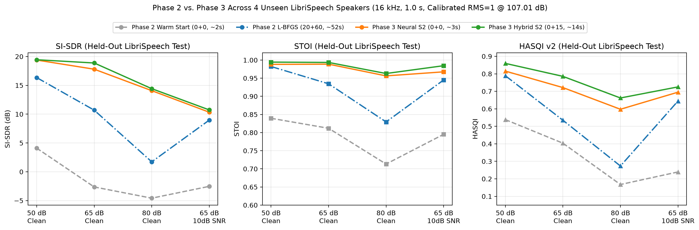
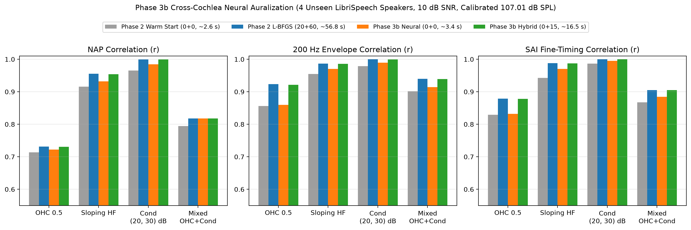

# carfac-inversion

Audio reconstruction and hearing-loss auralization from CARFAC Neural Activity
Patterns (NAPs) back to waveforms in JAX.

Built on top of [`hp-acoustic`](https://github.com/Australian-Future-Hearing-Initiative/hp-acoustic)
and [`carfac`](https://github.com/google/carfac).

## Overview

CARFAC v2 ([Lyon, 2011](#references); [Lyon, 2017](#references);
[Lyon et al., 2024](#references)) transforms waveforms through a cascaded
asymmetric resonator filterbank (`car_step`), asymmetric hair-cell
rectification (`ihc_detect`), two-capacitor adaptation (`ihc_step`), an 80 µs
low-pass filter (~2 kHz cutoff), and auditory nerve synapse modeling (`syn_step`)
using the canonical CARFAC acoustic reference (`0 dBFS` sine peak = `104 dB SPL`,
i.e., `RMS = 1.0 ≈ 107.01 dB SPL` via `sii.CARFAC_RMS_ONE_DB_SPL`). Below
~2–4 kHz, NAPs preserve fine temporal phase-locking; above ~4 kHz, carrier phase
is attenuated into positive temporal envelopes.

`carfac-inversion` supports physics-grounded iterative inversion, hybrid
residual refinement, and direct causal neural synthesis in up to four
components:

1. **Physics-Based CARFAC DSP Warm Start (`dsp_warm_start`)**:
   - Measures open-loop CARFAC basilar-membrane impulse responses (duration-capped
     at `~0.15 s` up to `8192` samples to accommodate high-Q / `48 kHz` tails)
     through any configured conductive and middle-ear front-end filters at a
     per-ear AGC-damped operating Q (`ohc_scale`), extending scalar gain search
     brackets down to `1e-7` for retuned high-gain CARFAC configurations.
   - Two-pass apical recovery: Pass 1 inverts channels at or above
     `min_warm_start_cf_hz` (`250 Hz`) so quadratic `ohc_nlf` combination-tone
     distortion is excluded from initial phase recovery; Pass 2 subtracts the
     orthogonalized Pass-1 closed-loop CARFAC response to recover unexplained
     `< 250 Hz` low-frequency drive without amplifying combination-tone
     artifacts.
   - Compensates discrete-time IHC + synapse `lpf_coeff` phase lag and rolloff
     below `hf_crossover_hz` (`4200 Hz`), extracts high-pass-cleaned envelopes
     modulated onto bandlimited noise above `hf_crossover_hz`, and calibrates
     per-channel RMS SPL plus 1-shot spectral tilt equalization.
2. **Optional Dual-Domain Neural Residual Refiner (`neural.py`, [`train_neural_refiner.py`](src/carfac_inversion/scripts/train_neural_refiner.py))**:
   - When `InversionConfig.neural_checkpoint` is set, runs a `1.3M`-parameter
     (`1,297,790` params) Flax ConvNeXt STFT + sample-rate 1D U-Net refiner
     (`NapResidualRefiner`) conditioned on canonical log-CF (`40–7200 Hz`)
     target NAPs, (`target_nap - ws_nap`) residual statistics, and physical
     SPL (`log10(ws_rms)`).
   - Zero-initialized synthesis heads predict a global SPL multiplier
     (`exp(delta_g)`), complex STFT ratio mask + additive complex STFT
     residual (`n_fft=256, hop=64`), and a sample-aligned 1D U-Net tail
     (`unet_base_dim=24`), initialized at exact identity (`max |out - x_ws| < 1e-6`,
     exact `0.0` on silence).
   - Recovers high-SPL (`>= 80 dB SPL`) AGC compression and synthesizes
     `>4 kHz` harmonic/fricative fine structure in a single feedforward pass
     (`~15 ms/s` neural forward, `~3 s/clip` total at `0+0` vs `~111 s` L-BFGS),
     optionally followed by a brief L-BFGS polish (`0+15`).
   - Trained for each inversion mode on speaker-disjoint LibriSpeech `dev-clean`:
     - **Phase 3 (`mode="exact"`, `phase3_refiner.npz`)**: Two-stage training
       (`32` train speakers / `766` windows spanning `43–86 dB SPL` +
       clean/noisy; `4` val speakers / `64` windows; `4` test speakers): Stage 1
       (`1400` steps) optimizes re-balanced multi-resolution STFT
       (`2048/1024/512/128`), `3.8–7.8 kHz` HF log-magnitude MSE, RMS-normalized
       L1, `log_rms`, `-SI-SDR`, and `<20 Hz` drift (`val_sisdr -3.41 -> +12.06 dB`);
       Stage 2 (`350` steps) adds differentiable CARFAC NAP + `>3.5 kHz` envelope
       cycle consistency (`carfac_nap` val MSE `0.0950 -> 0.0711`).
     - **Phase 3b (`mode="perceptual"`, `phase3b_perceptual.npz`)**:
       Self-supervised differentiable CARFAC perceptual training
       (`--objective=perceptual`, `900` steps, `batch=8`, `720` train windows
       across `16` impairment profiles spanning OHC loss, sloping HF loss,
       conductive loss, middle-ear filtering, `v_half_shift`, and
       `fiber_retention`; `96` val windows across `8` held-out profiles):
       minimizes `2 ms`/`8 ms` NAP envelopes, SAI fine timing, `0.30` raw NAP
       MSE, `<35 Hz` drift, and HF smoothness (`hf_diff_weight=0.03`), lowering
       val perceptual loss from `0.2635 -> 0.1722` (`val NAP corr 0.7998 -> 0.8393`).
       Checkpoints record `target_mode` (`"exact"` or `"perceptual"`) and log
       a warning if paired with the opposite inversion mode.
3. **Scale-Invariant JAX Optimization (`invert_nap`)**:
   - Projects iterates onto the audible band `[cutoff_low_hz, cutoff_high_hz]`
     (default low edge `35 Hz` with an `18 Hz` cosine taper) in rFFT space to
     preserve speech fundamentals while rejecting sub-audible DC drift.
   - Optimizes via `jax.lax.scan`-fused cosine-decayed Adam (`adam_steps=45`)
     and exact-secant RMS-normalized L-BFGS (`lbfgs_steps=135`,
     `lbfgs_memory_size=25`, `tpu.py`) with zero host sync barriers in two
     modes:
     - `mode="exact"`: Sample-level NAP MSE plus an HF-channel-normalized
       `>3.5 kHz` envelope anchor (`hf_env_weight=0.008`) for same-cochlea
       round-trip reconstruction.
     - `mode="perceptual"`: Blended global and channel-normalized multi-scale
       NAP envelopes (2 ms and 8 ms), Stabilized Auditory Image (SAI) matching,
       and a sample-level `perceptual_nap_weight` anchor (default `0.30`) for
       cross-cochlea hearing-loss auralization (inverting an impaired cochlea's
       NAP through a healthy cochlea even when OHC loss alters traveling-wave
       group delays).
   - Automatically chunks utterances longer than `chunk_seconds` (default
     `1.5 s`) with `chunk_overlap_s` (`0.128 s`) overlap-add blending, frozen
     preceding-audio pre-roll (`chunk_preroll_s`, `0.064 s`), and `CarfacState`
     carry via module-level JIT kernels so XLA compiles once and runtime scales
     linearly with duration.
4. **Direct Causal Neural Inverter ([`nap_inverter.py`](src/carfac_inversion/nap_inverter.py), [`vocoder_losses.py`](src/carfac_inversion/vocoder_losses.py), [`train_phase4.py`](src/carfac_inversion/scripts/train_phase4.py))**:
   - **Phase 4 (`CochleaDirectInverter`, `architecture="cochlea_hybrid"`, `488,323` params)** inverts full-band `32 kHz` CARFAC NAPs directly in a single causal pass (`8 ms` / `256`-sample lookahead) with no iterative optimization loop at inference time (`~0.3–0.7 s` warm on CPU).
   - Combines dual linear + log-compressed NAP scaling (`nap_log_scale=0.02`), a 1D band-Toeplitz-lowered `(3, 5) -> (1, 5)` causal tonotopic stem (`_CausalTonotopicStem`), a causal `2 ms` (`hop=64`) frame-rate envelope/AGC branch with FiLM + dynamic gain modulation, `nn.remat`-checkpointed dilated causal residual blocks (`width=64, num_blocks=13`), and an exact $O(\log T)$ modal `complex64` `jax.lax.associative_scan` 4th-order `20 Hz` Butterworth output high-pass (`vocoder_losses.causal_highpass`). Also implements [`arcfac`](https://github.com/Australian-Future-Hearing-Initiative/arcfac)'s baseline causal `tcn` (`229,569` params) for direct ablation.
   - Trained end-to-end on 8-core `vlp:2x4` TPU (`6.574 GB` HBM/core at `batch_size=64` via `grad_accum_steps=2` and multi-step `jax.lax.scan`) using streaming 1D waveforms (`ProcessedClips` via Grain) + on-TPU per-clip CARFAC NAP synthesis across randomized healthy/flat/sloping ears (`ears="mixture"` `0.25/0.35/0.40`, `mask=8000` / `0.25 s`, `warmup_weight=0.01`, healthy-only `lam=0.01` and MR-STFT `stft_weight=0.1`, `lam_impaired=0.0`).

## Installation

```bash
uv sync --dev
```

Or editable install into an existing environment with `hp-acoustic` and
`carfac`:

```bash
pip install --no-deps -e .
```

## Quickstart

```python
import jax.numpy as jnp
import numpy as np
from hp_acoustic.models import carfac
from carfac_inversion import InversionConfig
from carfac_inversion import invert_nap

healthy = carfac.build(fs=16000)
impaired = carfac.build(fs=16000, ohc_health=0.5)

# Same-cochlea round-trip reconstruction
nap_healthy = np.asarray(healthy(jnp.asarray(audio[:, None]))[:, :, 0])
roundtrip = invert_nap(nap_healthy, healthy)

# Cross-cochlea hearing-loss auralization
nap_impaired = np.asarray(impaired(jnp.asarray(audio[:, None]))[:, :, 0])
auralized = invert_nap(
  nap_impaired,
  healthy,
  InversionConfig(mode="perceptual"),
)

# Phase 4 direct 32 kHz single-pass causal inference (8 ms lookahead)
from carfac_inversion.nap_inverter import invert_nap_direct

direct_audio = invert_nap_direct(nap_32k, "/path/to/phase4_checkpoint.npz")
```

### CLI

Round-trip WAV reconstruction:

```bash
python -m carfac_inversion.scripts.invert_nap \
  --input_wav=input.wav \
  --output_wav=roundtrip.wav \
  --level_db_spl=65.0
```

Cross-cochlea hearing-loss auralization from OHC impairment or a fitted `.npz`
profile:

```bash
python -m carfac_inversion.scripts.invert_nap \
  --input_wav=input.wav \
  --output_wav=auralized.wav \
  --source_ohc_health=0.5 \
  --level_db_spl=65.0
```

Diagnostic benchmark suite across sample rates (`16/32 kHz`), levels, SNRs,
step budgets, and cross-cochlea auralization (supports raw WAV/FLAC directories,
`ProcessedClips` shards, or optional LibriSpeech `dev-clean` preparation):

```bash
python -m carfac_inversion.scripts.benchmark_suite \
  --input_dir=/path/to/wavs_or_shards \
  --output_dir=tmp/carfac_inversion_benchmark \
  --max_clips=3
```

Fast single-pass or hybrid neural reconstruction & training:

```bash
# Train 2-stage (spectral/waveform + differentiable CARFAC cycle) refiner:
python -m carfac_inversion.scripts.train_neural_refiner \
  --train_cache=/path/to/train_cache.npz \
  --val_cache=/path/to/val_cache.npz \
  --output_checkpoint=tmp/phase3_refiner.npz

# Invert in ~3 s/clip (0+0 feedforward) or ~14 s/clip (0+15 L-BFGS polish):
# (Download pre-trained 4.6 MiB `phase3_refiner.npz` from a GitHub Release asset
# when published, or produce it via `train_neural_refiner.py` above.)
python -m carfac_inversion.scripts.invert_nap \
  --input_wav=input.wav \
  --output_wav=roundtrip_p3.wav \
  --level_db_spl=80.0 \
  --neural_checkpoint=tmp/phase3_refiner.npz \
  --adam_steps=0 --lbfgs_steps=15

# Cross-cochlea Phase 3b perceptual training & fast 0+15 auralization (~16 s/clip):
python -m carfac_inversion.scripts.train_neural_refiner \
  --objective=perceptual \
  --train_cache=/path/to/phase3b_train_cache.npz \
  --val_cache=/path/to/phase3b_val_cache.npz \
  --output_checkpoint=tmp/phase3b_perceptual.npz

python -m carfac_inversion.scripts.invert_nap \
  --input_wav=input.wav \
  --output_wav=auralized_p3b.wav \
  --mode=perceptual \
  --source_ohc_health=0.5 \
  --neural_checkpoint=tmp/phase3b_perceptual.npz \
  --adam_steps=0 --lbfgs_steps=15

# Train Phase 4 direct causal CochleaHybrid inverter at 32 kHz with arcfac settings:
python -m carfac_inversion.scripts.train_phase4 \
  --data_dir=/path/to/librispeech_32k \
  --output_dir=tmp/phase4_hybrid \
  --architecture=cochlea_hybrid \
  --batch_size=64 \
  --grad_accum_steps=2 \
  --steps=2000 \
  --lr_schedule=cosine

# Head-to-head benchmark vs. iterative solvers and AFHI/arcfac baselines:
python -m carfac_inversion.scripts.benchmark_arcfac \
  --input_dir=/path/to/wavs_or_shards \
  --output_dir=tmp/arcfac_benchmark \
  --methods=phase4_direct,carfac_exact,arcfac_match_nap \
  --phase4_checkpoint=tmp/phase4_hybrid/checkpoint.npz
```

## Approach & Phased Evaluation Methodology

Every architectural improvement was driven by real-speech diagnostics in
[`benchmark_suite.py`](src/carfac_inversion/scripts/benchmark_suite.py) and
recorded with accepted/rejected ablations in
[`docs/evaluation_phases.md`](docs/evaluation_phases.md):

- **Phase 0 (`95e7a51`)**: Core open-loop CARFAC DSP warm start + rFFT-masked
  Adam/L-BFGS passed **17 / 17** synthetic unit tests, surfacing two gaps:
  unchunked XLA re-compilation on variable utterance lengths and no real-speech
  multi-SPL benchmark.
- **Phase 1 (`08d7700`, `a7b4025`)**: Added fixed-window OLA chunking
  (**22 / 22** tests) and built `benchmark_suite.py`. Real-speech evaluation
  exposed 4 concrete bottlenecks: `-2.5` to `-6.6 dB` SI-SDR on low-F0 speech
  (`long_test.wav`), suboptimal `40+40` secants, `80 dB` AGC compression +
  `> 4 kHz` sag, and `< 250 Hz` energy swamping `1–4 kHz` consonants in
  `mode="perceptual"`.
- **Phase 2a (`9970fa4`)**: Rejected naive unconditional `< 250 Hz` inversion
  (`binaural_test` regressed across all SPLs) and inverse-threshold frequency
  preconditioning `W_pre(f)` (`binaural_test` dropped `-4` to `-6 dB`). Even raw
  Pass-2 residual subtraction failed our `32 kHz` unit test (`9.68 dB < 10.0 dB`)
  until diagonal projection diagnosed `99.9%` of `< 250 Hz` NAP energy on that
  synthetic clip was quadratic combination-tone leakage; orthogonalizing Pass-1
  leakage fixed `32 kHz` (**23 / 23** tests) and lifted `long_test` by
  **`+12.6` to `+14.3 dB` SI-SDR**.
- **Phase 2b (`114cfc3`)**: Fixed an ~8x channel-averaging dilution bug in
  `hf_err`, switched `mode="perceptual"` to blended channel-normalized envelopes
  + `perceptual_nap_weight=0.30` (after testing and rejecting Pass-2 HF noise
  injection, all-channel `log1p` anchors, L-BFGS curvature resets,
  `adam_lr_scale` boosts, and `SaiPndLoss`).
- **Phase 3 (`70d15b8`)**: Trained and benchmarked `NapResidualRefiner` against
  L-BFGS optimization on both `carfac/test_data` and 4 completely unseen
  LibriSpeech `dev-clean` speakers (**28 / 28** tests), re-balancing
  `hp_acoustic`'s default `sqrt(win_len/2)` STFT loss scaling after an initial
  smoke check showed `stft=112.7` drowning `SI-SDR` and CARFAC cycle consistency.
- **Calibration Alignment & Retuned CARFAC Robustness (`f571baa`, `9da7cbf`)**:
  Aligned SPL scaling in `benchmark_suite.py` and `invert_nap.py` with
  `sii.CARFAC_RMS_ONE_DB_SPL` (`RMS = 1.0 ≈ 107.01 dB SPL`, `0 dBFS` sine peak
  `= 104 dB SPL`), added dynamic gain bounds + `1e-7` Adam/L-BFGS RMS floors
  for retuned high-gain CARFAC presets (reducing Option C `20 dB` warm-start
  gain error from `5.3x` to `1.01x`), scaled open-loop BM `ir_len` up to `8192`
  at `48 kHz`, and moved `ohc_scale` per ear after ablations showed per-channel
  `ohc_scale` hurt Phase 3 (`-1.7` to `-3.7 dB` SI-SDR). (**31 / 31** tests.)
- **Phase 3b (Self-Supervised Cross-Cochlea Neural Auralization)**: Trained a
  dedicated `mode="perceptual"` refiner (`phase3b_perceptual.npz`) end-to-end
  under differentiable CARFAC perceptual cycle loss (`2/8 ms` NAP envelopes +
  SAI fine timing + raw NAP + `<35 Hz` drift + `hf_diff_weight=0.03` HF hiss
  control), lifting `0+0` held-out cross-cochlea alignment (`NAP 0.8473 -> 0.8641`,
  `Env 0.9230 -> 0.9336`, `SAI 0.9063 -> 0.9205` across 4 unseen speakers x 4
  impairment profiles) and matching Phase 2 `20+60` (`56.78 s`) at `0+15` in
  `16.49 s` (`3.4x` faster; `NAP 0.8755`, `Env 0.9613`, `SAI 0.9425`,
  `HASQI 0.160`). (**34 / 34** tests.)
- **Week 0 TPU Runtime & `AFHI/arcfac` Benchmark Parity (`b28bc66`, `bbcf758`)**:
  Eliminated host sync barriers inside `invert_nap` and `train_neural_refiner`
  via `jax.lax.scan` optimization/training loops (`tpu.py`), added `CarfacState`
  carry across OLA pre-rolls, resolved all `pyrefly` checks (`0` errors), and
  added native `AFHI/arcfac` representation/direction metrics and solver
  benchmarks (`arcfac_metrics.py`, `benchmark_arcfac.py`). (**46 / 46** tests.)
- **Phase 4 Direct Causal `CochleaHybrid`, `tcn` Ablation & Cosine Scaling
  (`647e79b`)**: Built `CochleaDirectInverter` (`cochlea_hybrid`), lowered
  `_CausalTonotopicStem` from TPU-padded 2D convolutions (`44.94 GB` standalone
  compile HBM) to exact 1D band-Toeplitz convolutions (`<1 GB`) with
  `nn.remat` block checkpointing (`6.574 GB`/core at `B=64` via
  `grad_accum_steps=2` on `vlp:2x4`), isolated CPU metric calls with
  `tpu.host_cpu_context()`, beat `arcfac`'s `tcn` by `+3.85 dB` SI-SDR and
  `-36.5%` relative NAP error at Step 500 while running `24%` faster per TPU
  chunk (`55.66 s` vs. `73.57 s`), prepared `train-clean-100 @ 32 kHz`
  (`25,724` train / `2,815` test clips), and scaled cosine training to Step
  2,000 reaching `+23.35 dB` SI-SDR / `0.941` HASQI on `dev-clean/test` and
  `+20.96 dB` SI-SDR / `0.916` HASQI zero-shot on `train-clean-100/test`.
  (**56 / 56** tests.)

## What the Metrics Mean

| Metric | Domain & Range | What It Measures & How to Interpret It |
| :--- | :--- | :--- |
| **`SI-SDR`** | Waveform (dB) | **Scale-Invariant Signal-to-Distortion Ratio**: Sample-level carrier phase and waveform accuracy up to a global scalar. High `SI-SDR` (`> 10–20 dB`) indicates accurate `< 2–4 kHz` phase locking. *(In cross-cochlea `mode="perceptual"`, output reflects a healthy ear at impaired cochlear firing levels with different traveling-wave delays, so negative `SI-SDR` is expected and uninformative there.)* |
| **`SNR`** | Waveform (dB) | **Signal-to-Noise Ratio**: Penalizes global SPL/volume mismatches directly (`ws/ref != 1.0`), making it essential at `80 dB SPL` where linear warm starts under-predict level due to OHC AGC compression. |
| **`STOI`** | Perceptual (`0–1`) | **Short-Time Objective Intelligibility**: Correlates temporal amplitude envelopes across ~1/3-octave critical bands (`> 0.90` = high intelligibility); robust to `> 4 kHz` random-carrier phase ambiguity. |
| **`HASPI v2`** | Auditory (`0–1`) | **Hearing-Aid Speech Perception Index**: Auditory-nerve intelligibility model calibrated to an audiogram (`1.0` = ceiling intelligibility). |
| **`HASQI v2` (`nl` / `lin`)** | Auditory (`0–1`) | **Hearing-Aid Speech Quality Index (`HASQI = nl * lin`)**: Separates **`HASQI_lin`** (long-term spectral tilt) from **`HASQI_nl`** (cepstral spectral-envelope smoothness + temporal modulation); sensitive to `4.2–7.5 kHz` fricative naturalness and tonal harmonics vs. noise. |
| **`NAP corr` / `Env corr` / `SAI corr`** | Cochlear (`-1` to `1`) | **Forward Manifold Consistency**: Passes reconstructed audio back through the target cochlea (`carfac`) to verify exact neural firing alignment (`NAP corr`), `200 Hz`-smoothed temporal envelopes (`Env corr`, phase-tolerant), and Stabilized Auditory Images (`SAI corr`, pitch/timbre periodicity)—the primary ground truth for cross-cochlea auralization. |
| **`nap_rt_rel` / `sai_rt_rel`** | `arcfac` (`0` = exact) | **Relative Cochlear Round-Trip L1**: Masked (`>= mask`) L1 distance `||H(y) - T(x)|| / ||H(x)||` in NAP (`nap_rt_rel`) or SAI (`sai_rt_rel`) space relative to healthy target speech energy. |
| **`nap_kept` / `sai_kept`** | `arcfac` (`0` = exact) | **Impaired Target Residual Relative to Loss Shift**: Ratio `||H(y) - T(x)|| / ||T(x) - H(x)||` quantifying reconstruction error relative to the hearing-loss difference (`< 0.25` preserves loss selectivity cleanly). |
| **`nap_dir` / `sai_dir` & `off_axis`** | `arcfac` (`1.0` / `0.0`) | **Hearing-Loss Direction Fidelity**: Regresses reconstructed healthy shift `H(y) - H(x)` onto target hearing-loss shift `T(x) - H(x)` (`direction` ideal `= 1.0`) and measures orthogonal spurious deviation share (`off_axis` ideal `= 0.0`). |
| **`log_stft`** | Spectral (`0` = exact) | **`arcfac.match` Multi-Resolution `-60 dB` Floored Log-STFT L1**: Scale-free perceptual spectral distance across `512 / 1024 / 2048` windows. |
| **Band SNRs (`60–300` … `4k5–7k5 Hz`)** | Spectral-Time (dB) | **Frequency Diagnostics**: `60–300 Hz` catches missing `< 250 Hz` pitch fundamentals (`F0`); `300–2200 Hz` tracks vowel formants & `80 dB` compression recovery; `4500–7500 Hz` isolates `> 4 kHz` synthesis above CARFAC's ~2 kHz IHC LPF. |

## Evaluation Results

### Phase 4 Direct Causal Inverter (32 kHz, 8 ms Lookahead) — Latest KPIs

Trained on 8-core `vlp:2x4` TPU (`~55.66 s` per 25-step scan chunk at `batch_size=64` via `grad_accum_steps=2`, `6.574 GB` temporary HBM/core) with `arcfac` settings (`librispeech_dev_clean_32k`, `ears="mixture"` `0.25/0.35/0.40`).

**1. Test-Set Generalization & Backbone Ablation (`2.0 s @ 32 kHz`, `65 dB SPL`)**:

| Model & Step | Test Split (Clips) | Target | `nap_rt_rel` (↓) | `sai_rt_rel` (↓) | `nap_kept` (↓) | `nap_dir` / `sai_dir` (→1.0) | `log_stft` (↓) | `SI-SDR` (↑) | `HASQI` (↑) | Runtime / Clip |
| :--- | :--- | :--- | ---: | ---: | ---: | :---: | ---: | ---: | ---: | :---: |
| `arcfac` `tcn` (`229.6k`, Step 500) | `dev-clean/test` (`2`) | `healthy` | 0.256 | 0.208 | — | — | — | +11.33 dB | — | — |
| `arcfac` `tcn` (`229.6k`, Step 500) | `dev-clean/test` (`2`) | `flat:0.5` | — | — | 0.251 | — / 0.833 | — | — | — | — |
| `cochlea_hybrid` (`488.3k`, Step 500) | `dev-clean/test` (`2`) | `healthy` / `flat:0.5` | 0.162 | 0.152 | 0.208 | — / 1.007 | — | +15.18 dB | — | — |
| `cochlea_hybrid` (Step 500) | `dev-clean/test` (`5`) | `healthy` | 0.169 | 0.153 | — | — | 0.082 | +15.14 dB | 0.819 | `0.55–0.80 s` |
| **`cochlea_hybrid` (Step 2,000)** | `dev-clean/test` (`5`) | `healthy` | **0.075** | **0.055** | — | — | **0.049** | **+23.35 dB** | **0.941** | **`0.70–1.29 s`** |
| **`cochlea_hybrid` (Step 2,000)** | `dev-clean/test` (`5`) | `flat:0.5` | 0.915 | 0.931 | **0.208** | **1.006 / 1.004** | 0.370 | -7.17 dB | 0.055 | `0.71 s` |
| **`cochlea_hybrid` (Step 2,000)** | `dev-clean/test` (`5`) | `sloping` | 0.892 | 0.685 | **0.186** | **0.948 / 0.879** | 0.337 | -7.07 dB | 0.234 | `0.70 s` |
| **`cochlea_hybrid` (Step 2,000)** | `train-clean-100/test` (`5`, zero-shot) | `healthy` | **0.074** | **0.053** | — | — | **0.061** | **+20.96 dB** | **0.916** | **`0.70–1.17 s`** |
| **`cochlea_hybrid` (Step 2,000)** | `train-clean-100/test` (`5`, zero-shot) | `flat:0.5` | 0.924 | 0.959 | **0.177** | **1.000 / 1.000** | 0.486 | -5.37 dB | 0.044 | `0.68 s` |
| **`cochlea_hybrid` (Step 2,000)** | `train-clean-100/test` (`5`, zero-shot) | `sloping` | 0.875 | 0.701 | **0.160** | **0.949 / 0.887** | 0.450 | -2.10 dB | 0.288 | `0.70 s` |

**2. Multi-SPL Dynamic-Range Audit (`30–95 dB SPL`, `3` Unseen `dev-clean/test` Clips, `2.0 s @ 32 kHz`)**:

| Level (dB SPL) | `arcfac` `tcn` s500 `healthy` (`nap_rt` / `SI-SDR` / `HASQI`) | `cochlea_hybrid` s500 `healthy` (`nap_rt` / `SI-SDR` / `HASQI`) | **`cochlea_hybrid` s2000 `healthy`** (`nap_rt` / `SI-SDR` / `HASQI`) | **`s2000 flat:0.5`** (`nap_dir` / `sai_dir`) |
| ---: | :---: | :---: | :---: | :---: |
| **30** | 0.154 / +7.10 dB / 0.927 | 0.141 / -1.29 dB* / 0.846 | **0.040 / +9.63 dB / 0.945** | **0.995 / 1.000** |
| **50** | 0.254 / +10.03 dB / 0.841 | 0.153 / +13.30 dB / 0.887 | **0.058 / +23.67 dB / 0.976** | **0.999 / 1.000** |
| **65** | 0.260 / +10.99 dB / 0.714 | 0.170 / +14.60 dB / 0.809 | **0.077 / +22.57 dB / 0.940** | **1.002 / 0.999** |
| **80** | 0.222 / +12.80 dB / 0.650 | 0.169 / +14.89 dB / 0.756 | **0.085 / +20.72 dB / 0.906** | **0.869 / 0.636** |
| **95** | 0.253 / +9.57 dB / 0.608 | 0.209 / +11.74 dB / 0.709 | **0.107 / +17.14 dB / 0.841** | **0.717 / 0.513** |

*\*Post-mask (`>=8000` samples) SI-SDR at `30 dB` for `cochlea_hybrid` Step 500 was `+15.85 dB` vs. `tcn`'s `+15.45 dB`; full-clip `30 dB` SI-SDR resolved cleanly to `+9.63 dB` by Step 2,000.*

**3. Head-to-Head vs. Iterative Solvers & `AFHI/arcfac` (`1.0 s @ 32 kHz` Real Speech, `65 dB SPL`)**:

| Method | Target | `nap_rt_rel` (↓) | `sai_rt_rel` (↓) | `nap_kept` (↓) | `nap_dir` / `sai_dir` (→1.0) | `log_stft` (↓) | `SI-SDR` (↑) | `HASQI` (↑) | CPU Time (↓) |
| :--- | :--- | ---: | ---: | ---: | :---: | ---: | ---: | ---: | ---: |
| **`phase4_direct` (`cochlea_hybrid` s500)** | `healthy` | 0.146 | 0.154 | — | — | **0.189** | **+9.34 dB** (`+12.31 >=8k`) | **0.495** | **0.29–1.62 s** |
| **`phase4_direct` (`cochlea_hybrid` s2000)** | `healthy` | **0.078** | **0.072** | — | — | 0.196 | +5.27 dB (**`+15.79 >=8k`**) | 0.348 | **0.37–2.83 s** |
| `carfac_exact` (Adam+LBFGS) | `healthy` | 0.158 | 0.133 | — | — | 0.703 | +5.73 dB | 0.106 | 78.39 s |
| `carfac_perceptual` (Adam+LBFGS) | `healthy` | 0.176 | 0.099 | — | — | 0.669 | +5.77 dB | 0.160 | 96.15 s |
| `arcfac_match_nap` (noise / randphase) | `healthy` | 0.368 / 0.400 | 0.253 / 0.305 | — | — | 2.538 / 0.531 | -10.02 / -7.75 dB | 0.064 / 0.159 | ~137 s |
| `arcfac_match_sai` (noise / randphase) | `healthy` | 1.244 / 1.342 | 0.208 / 0.167 | — | — | 2.528 / 0.575 | -23.03 / -18.82 dB | 0.017 / 0.252 | ~150 s |
| `arcfac_slaney` | `healthy` | 1.098 | 0.858 | — | — | 2.366 | -44.47 dB | 0.033 | 158.45 s |
| **`phase4_direct` (`hybrid` s500 / s2000)** | `flat:0.5` | 0.911 / 0.907 | 0.963 / 0.961 | **0.174 / 0.169** | **1.000 / 1.000** · **1.002 / 1.007** | 0.646 / 0.633 | -6.23 / -8.65 dB | 0.038 / 0.025 | **0.29 / 0.37 s** |
| `carfac_exact` | `flat:0.5` | 0.915 | 0.967 | **0.169** | 1.014 / 1.016 | 0.595 | -7.53 dB | 0.040 | 52.89 s |
| `arcfac_match_nap` (noise / randphase) | `flat:0.5` | 1.031 / 0.992 | 1.008 / 0.879 | 0.338 / 0.407 | 1.011 / 1.014 · 0.856 / 0.539 | 2.518 / 0.618 | -29.52 / -13.34 dB | 0.015 / 0.065 | ~135 s |

### Phase 2–3b Iterative & Hybrid Refiner Baselines (16 kHz)



Headline metrics on **4 held-out LibriSpeech speakers** (`[7850, 7976, 8297, 8842]`, `16 kHz`, `1.0 s` windows; 100% unseen during neural training, calibrated under `sii.CARFAC_RMS_ONE_DB_SPL ≈ 107.01 dB SPL`):

| Condition | Method | Runtime | SI-SDR | STOI | HASPI | HASQI / nl | 4.5–7.5 kHz SNR |
| :--- | :--- | :---: | :---: | :---: | :---: | :---: | :---: |
| `50 dB` clean | DSP Warm Start (`0+0`) | `3.36 s` | `4.10 dB` | `0.8394` | `0.9998` | `0.538 / 0.644` | `0.0 dB` |
| `50 dB` clean | DSP + L-BFGS (`20+60`) | `53.79 s` | `16.34 dB` | `0.9822` | `0.9999` | `0.789 / 0.822` | `-4.8 dB` |
| `50 dB` clean | **DSP + Neural (`0+0`)** | **`3.08 s`** | `19.39 dB` | `0.9881` | `0.9999` | `0.815 / 0.858` | `-1.6 dB` |
| `50 dB` clean | **DSP + Neural + L-BFGS (`0+15`)** | `15.89 s` | **`19.44 dB`** | **`0.9943`** | **`1.0000`** | **`0.860 / 0.898`** | `-1.6 dB` |
| `65 dB` clean | DSP Warm Start (`0+0`) | `2.17 s` | `-2.64 dB` | `0.8119` | `0.9983` | `0.404 / 0.520` | `0.0 dB` |
| `65 dB` clean | DSP + L-BFGS (`20+60`) | `51.53 s` | `10.69 dB` | `0.9346` | `0.9988` | `0.535 / 0.569` | `-4.7 dB` |
| `65 dB` clean | **DSP + Neural (`0+0`)** | **`3.21 s`** | `17.80 dB` | `0.9887` | `0.9996` | `0.721 / 0.761` | `-1.0 dB` |
| `65 dB` clean | **DSP + Neural + L-BFGS (`0+15`)** | `14.68 s` | **`18.88 dB`** | **`0.9935`** | **`0.9999`** | **`0.785 / 0.822`** | **`-1.0 dB`** |
| `80 dB` clean | DSP Warm Start (`0+0`) | `2.30 s` | `-4.58 dB` | `0.7132` | `0.7036` | `0.168 / 0.215` | `-0.8 dB` |
| `80 dB` clean | DSP + L-BFGS (`20+60`) | `51.22 s` | `1.72 dB` | `0.8294` | `0.8682` | `0.273 / 0.331` | `-3.6 dB` |
| `80 dB` clean | **DSP + Neural (`0+0`)** | **`3.33 s`** | `14.08 dB` | `0.9564` | `0.9995` | `0.598 / 0.632` | `-1.2 dB` |
| `80 dB` clean | **DSP + Neural + L-BFGS (`0+15`)** | `13.59 s` | **`14.42 dB`** | **`0.9629`** | **`0.9997`** | **`0.662 / 0.697`** | **`-1.1 dB`** |
| `65 dB`, 10 dB SNR | DSP + L-BFGS (`20+60`) | `51.72 s` | `8.97 dB` | `0.9450` | `1.0000` | `0.644 / 0.695` | `-0.1 dB` |
| `65 dB`, 10 dB SNR | **DSP + Neural (`0+0`)** | **`3.28 s`** | `10.33 dB` | `0.9675` | `0.9999` | `0.695 / 0.729` | `-1.7 dB` |
| `65 dB`, 10 dB SNR | **DSP + Neural + L-BFGS (`0+15`)** | `14.58 s` | **`10.73 dB`** | **`0.9844`** | **`1.0000`** | **`0.725 / 0.755`** | `-1.7 dB` |

Highlights on canonical out-of-domain `carfac/test_data` (`binaural_test.wav` & `long_test.wav`) & scope boundaries:
- **Round-trip (`mode="exact"`, DSP + `45+135` L-BFGS @ `~110 s` -> DSP + Neural + `0+15` L-BFGS @ `~14–26 s`)**: `binaural_test` reached `SI-SDR 16.80 dB / STOI 0.9864` at `50 dB`, `SI-SDR 9.26 -> 9.44 dB` / `STOI 0.9204 -> 0.9843` at `65 dB`, and `STOI 0.8471 -> 0.9049` / `HASPI 0.9989 -> 0.9986` / `SI-SDR 1.38 -> 1.06 dB` at `80 dB` (`ws/ref 0.247 -> p3/ref 0.860`); `long_test` improved from `10.47 -> 13.59 dB` (`13.91 dB` at `0+0`) at `65 dB` and `8.53 -> 12.11 dB` at `80 dB`.
- **Cross-cochlea auralization (`mode="perceptual"`, Phase 2 `45+135` vs. Phase 3b `0+0` / `0+15`)**:



  - **Held-out LibriSpeech (`4` unseen speakers × `4` impairment profiles `ohc05`, `sloping`, `cond_20_30`, `mix_ohc06_cond`, `10 dB` SNR = `16` paired cases)**:
    - Phase 2 Warm Start (`0+0`, `2.59 s`): `NAP 0.8473 | Env 0.9230 | SAI 0.9063 | STOI 0.9584 | HASPI 0.9052 | HASQI 0.144`
    - Phase 2 L-BFGS (`20+60`, `56.78 s`): `NAP 0.8760 | Env 0.9622 | SAI 0.9430 | STOI 0.8400 | HASPI 0.8991 | HASQI 0.165`
    - **Phase 3b Neural (`0+0`, `3.39 s`)**: `NAP 0.8641 | Env 0.9336 | SAI 0.9205 | STOI 0.8420 | HASPI 0.8797 | HASQI 0.141`
    - **Phase 3b Hybrid (`0+15`, `16.49 s`)**: `NAP 0.8755 | Env 0.9613 | SAI 0.9425 | STOI 0.8321 | HASPI 0.8856 | HASQI 0.160` (`3.4x` faster than `20+60`)
  - **Canonical `carfac/test_data` (`8` clips)**: `Phase 3b 0+15` (`15.37 s`) reaches `NAP 0.7981 | Env 0.9292 | SAI 0.9348 | HASPI 0.9379 | HASQI 0.201`, vs. Phase 2 `20+60` (`54.75 s`: `0.8127 / 0.9428 / 0.9425`) and `45+135` (`~120 s`: `0.8159 / 0.9464 / 0.9437`). Pass `target_mode="perceptual"` checkpoints (e.g. `phase3b_perceptual.npz`) via `--perceptual_neural_checkpoint` in `benchmark_suite.py` or `--neural_checkpoint` in `invert_nap.py --mode=perceptual`; using an `"exact"` checkpoint in `mode="perceptual"` now logs a clear mismatch warning.

See [`docs/evaluation_phases.md`](docs/evaluation_phases.md) for the complete Phase 0–3b ablation log, accepted/rejected hypotheses, training details, and per-clip tables (**56 / 56** pytest tests passing across `inversion_test.py` (18), `neural_test.py` (8), `benchmark_suite_test.py` (6), `tpu_test.py` (5), `invert_nap_test.py` (4), `nap_inverter_test.py` (4), `vocoder_losses_test.py` (4), `arcfac_metrics_test.py` (3), `benchmark_arcfac_test.py` (2), and `train_phase4_test.py` (2)).

## Development

```bash
ruff format --check .
ruff check .
pyrefly check
pytest -v
```

## References

- Lyon, R. F. (2011). *Cascades of two-pole–two-zero asymmetric resonators are
  good models of peripheral auditory function*. JASA 130(6), 3893–3904.
- Lyon, R. F. (2017). *Human and Machine Hearing: Extracting Meaning from Sound*.
  Cambridge University Press.
- Lyon, R. F., Schonberger, R., Slaney, M., Velimirović, M., & Yu, H. (2024).
  *The CARFAC v2 Cochlear Model in Matlab, NumPy, and JAX*.
  [arXiv:2404.17490](https://arxiv.org/abs/2404.17490).
- [CARFAC](https://github.com/google/carfac)
- [hp-acoustic](https://github.com/Australian-Future-Hearing-Initiative/hp-acoustic)
- [arcfac](https://github.com/Australian-Future-Hearing-Initiative/arcfac)
